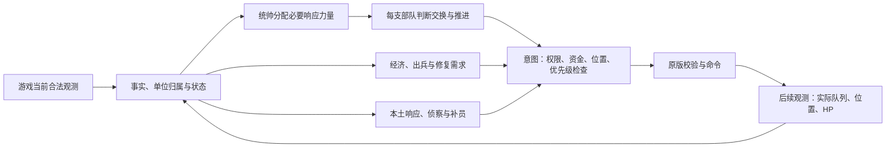

# Rusted Warfare Agent 使用说明：它在想什么，各系统怎样合作

这份说明对应八爪鱼 R8 / G6 起步候选。它是一个通过原版游戏接口读取局面、提出指令的自动玩家。它没有读取隐藏敌人的权限，也不是让一个大模型每隔几毫秒讨论战术。运行时主要由已有 Java 规则和状态机工作：不同系统负责不同职责，最后经过统一的权限、预算和原生命令检查。当前[执行与恢复契约](OCTOPUS_G54_EXECUTION_FLOW.md)、[重坦/侦察/修复契约](OCTOPUS_G55_HEAVY_RECON_HOME_REPAIR.md)、[R7 空海与运营契约](OCTOPUS_G6_EARLY_ENDGAME.md)、[R8 持续执行契约](OCTOPUS_R8_CONTINUING_OPERATIONS.md)记录具体证据与待验收边界。

R8 重点让已经选定的工作继续落实：Builder 的同一施工接受后等待现场证据，不重复付款；General 到中途路点后继续走向原本的信息前沿；空中编队保留完整合法路线，到路口或处理当前目标后继续探索。当前己方快照中缺席的单位只让对应提案被拒绝，不能让整局异常退出。操作量没有全局人为额度，但大军运行仍可能因读取与处理变慢；自然Spain跑满80分钟还没有原版胜利，侦察者长期存活和最终清图仍待验证。

这次默认不造小坦：首厂先出一只侦察者，使用独立 Recon 控制权收集信息；普通工厂沿实际原生升级链取得重坦菜单后持续出重坦。选中的升级账单受到资金保护，不能让不断买便宜单位或 Builder 把升级资金一直花掉。修复施工者先回基地附近再找合法站点。基地的当前交换估计已通过时，记忆防区不再再次否决该次攻城；失联目标和未知信息仍不能当成进攻事实。这些规则的实际收益以本轮自然局和后续真人测试为准。

## 这次怎样让几个系统配合起来

统帅现在先问“这个威胁需要多少力量、已有本土响应覆盖多少、还缺多少”，先让附近兼容的 FREE 处理小骚扰，再决定是否打断某支部队。选择时考虑原任务中断成本；一支够用就不把其他几支一起拉走。General 保留自己的长期推进方向与当前路点，处理战斗/危机后继续开拓。面对具体目标仍估算兼容火力、拆除时间、接近损失和可能交换；未知机制仍保持未知，估算不是精确模拟。

曾经合法看见的敌基地留下一个防区记忆，主要保护小编制：可正常参战的健康地面成员11台以内时避免普通旅行进入，超过11台允许普通推进。具体战斗仍由 FightEstimate 处理。基地失联只留下旅行限制，不允许攻击隐藏位置，也不证明它仍活着；确切销毁证据才能清除防区。

生产把资源持续变成军力，Commander 决定军力怎样组织。普通工厂有合法产品、钱够且保护真正已选择的关键支出时继续生产；armyTarget 用于编制，不再总停机。默认不设 Agent 的512兵力或5工厂软件上限，显式用户上限仍有效，原版真实上限未知。军队可以补员、逐渐扩编并形成新的 General。Builder 扩充依据当前已准备开发、真实可执行的并行工作和实际忙闲施工者；地图上远方潜在矿区不能直接变成采购订单。矿升级与工厂增长仍使用真实报价和承诺。T3强化是防御投资，不会冒充收入增加。

执行上，独立工厂、Builder、General 与伤兵不再共享人为操作额度。权限、同一单位冲突、重复命令、钱与生产槽位保护仍在；高优先级任务在兵力控制收集阶段先处理实际冲突，每轮施工、生产和普通部队各自获得服务。当前原生命令明确仍在前往有效目标时继续使用；真实目标、命令或控制权改变才替换。工厂、Builder、General各有任务，收入与施工能力共同决定滚雪球的速度；这一长期效果还需要真人长局验证。

严重伤兵（当前HP低于25%）交给独立恢复池，停止旧进攻，优先走向当前己方修复湾；修复需求随人数和缺血量增长。只有后帧实际HP达到75%，才回FREE并重新分配。没有修复湾时只安排一次回家等待，不反复发高优先级移动；一个实际选定的原生修复湾可以通过现有建设资金承诺筹资。命令接受不等于修复。Spain 自然局已出现实际恢复回 FREE，规模化效率与真人局效果仍需要验证。

首只 Scout 的默认工作是持续获取新信息。少量新视野只是进展，不立刻撤销任务；危险改变路线，实际严重损伤仍先回撤。恢复后的侦察者应重新使用自己的长期任务，不会被归为残血坦克消耗掉。R7 也让产能统计适应真实较慢的循环：相邻合法端点支持的区间可进入窗口，过长空白与过期菜单仍未知，不伪装成连续原生监控。

开启 G6 后，空闲、无当前 Capability 承诺的两栖飞机可以真正转交独立 `air-general:1`，后帧集合后共同搜索空海空间。它有自己的控制权、成员与持续路线，不加入地面 General。当前可见目标才能产生新攻击，潜水和起飞逐成员取真实模式证据。后方工程师沿当前原生施工菜单继续制造飞机；长期现金仍净增长、已投入空海能力且没有真实基础设施缺口时，闲置本土 Builder 可以建资源制造仪，再走原生升级链。下一架飞机和普通重坦生产的真实账单仍受保护。

## 先理解三个层次

| 层次 | 本质 | 一个例子 |
|---|---|---|
| 看见了什么 | 己方状态、当前合法可见敌情、地图固定知识，以及各自的来源时间 | 矿点固定在那里；敌方是否正在占矿，必须当前合法看见才能知道 |
| 想做什么 | 系统根据职责提出任务，保留任务状态与承诺 | 工程师已经赶到北部矿区，继续开发附近矿，而不是每轮重新跨图选点 |
| 能不能执行 | 指令提出时检查控制权、代际、钱、生产位置、节奏，原版最后检查动作是否合法 | 工厂菜单有这个单位且报价可负担，才申请生产；收到回执以后仍等队列或单位出现 |

“命令被接受”只是游戏收到了请求。它不等于坦克已到达、矿已建好、飞机已潜水，也不等于敌人已被击杀。后续观测才可以证明相应结果。

## 从零军队开局到正式出征

1. **经济建立基础。** 运营系统寻找可用建造者；没有时走已有恢复生产链。它根据当前原版菜单和建设规划生产、建矿、安排工厂，保留钱和施工承诺，避免多个任务重复花同一笔预算。
2. **先验地图帮助扩张。** 固定地图知识提供边界、地形和矿点。运营可以安排建造者去尚未看见的固定矿点附近，但不会宣称那里安全、空闲或已经可以施工。实际造矿仍要通过原版检查。
3. **新战斗单位进入 FREE。** FREE 是尚未正式分配的兵力池，可以做低优先级本土活动。当没有有效将军而出现第一名健康、已完成的普通战斗单位，创建第一支 FORMING General；目标规模沿用现有主力需求，不锁成一辆坦克。
4. **补员自己去集合。** FREE 被预定给某个 General 后成为 PENDING_JOIN；如果正在响应本土骚扰，先完成响应。随后进入 JOINING，自己走到目标部队附近。严格后帧位置证据确认到达，才 ATTACHED，交给该 General 控制。
5. **成军前也有作用。** FORMING 的少量成员可以向早期扩张点附近集结、提供轻量掩护，响应当前可见的本土敌情；不会让第一辆坦克独自远征。健康 ATTACHED 达到现有成军阈值 6 后变为 ACTIVE。
6. **正式作战与持续运营同时进行。** ACTIVE General 使用当前合法目标、地形与原版接敌检查推进。后方继续造兵、补员、扩矿和投资。已有部队满编、健康 FREE 兵力符合条件时，可以自然形成更多独立 General，不把所有兵重新合成一团。

这不是固定的“第几秒一定造什么”。原版菜单、资金、已有承诺、敌情、可达证据和当前兵力会影响实际推进。

图中最后一段是闭环的关键：收到命令回执以后，系统仍要等后续事实，才能说“钱已花、兵到了、伤修好了”。优先级批收集目前只完整覆盖兵力控制相关路径，不能把这张职责图理解成所有系统已经同时提交给全局调度器。

## 每个系统负责什么

| 系统 | 职责与合作关系 |
|---|---|
| GameClock / 观测身份 | 区分游戏来源时间、检测时间和电脑时间。每个端点有独立身份和新鲜度；不同接口回复不能假装是同一帧的原子世界。 |
| WorldState / Event Adapter | 只读共享事实与合法快照差分。失联是失联，缺席是缺席，UNKNOWN 保持未知。旧策略仍主要读取原响应，不能把共享状态称为已全面取代旧策略。 |
| Static Map Knowledge | 每局缓存地图静态矿点与地形。帮助扩张和判断移动域，不读取迷雾下的单位、建筑或动态阻塞。 |
| Economy / Production | 管钱、建造者、矿、工厂和普通出兵。已付款但尚未在观测中显现的生产仍占预算与位置，防止重订、超支。 |
| Strategy / Investment | 在已有链路上判断军队需求、技术与投资，安排工程师、provider 和特殊能力任务。General 的普通战斗单位可以被只读评估计入兵力，但运营不能因此抢走其控制权。 |
| Prospect Commitment | 为长途扩张保留局部承诺。建造者到达一个矿区后优先利用当地机会；资金不足或信息未知不会轻易把它拉去地图另一头。危险、接管或可靠的当地无机会证据可以释放承诺。 |
| Recon | 用合法侦察扩大当前视野与地形证据。侦察有独立 owner 和任务，不会把 last-known 敌人当成当前目标。 |
| GeneralRegistry / ForceController | 记录每个 General 的独立身份、成员和预定补员；管理 FREE、LOCAL_RESPONSE、JOINING、ATTACHED 流转。每个单位同一时刻只有一个有效 command owner。 |
| Commander | 给多个 General 分配已有当前可见威胁与目标，协调补员、已有危机和集结需求。每支 General 仍独立作战，不由一个全局命令把所有部队拧成同一队。 |
| GeneralCombatDirector / CombatLedger | 每支部队独立观察自身 HP 变化、当前可见压力、后援与目标机会，决定推进、换目标、保持距离或撤退。HP 是粗略代理，不是精确战力，也没有虚构 K/D 或击杀归因。 |
| LocalResponse / LocalCrisis | 对当前合法可见本土敌情作响应。普通响应相关敌人不再当前可见时立即清除；这是任务结束，不是证明敌人死亡。临时从 General 分出去的兵完成后回 FREE，随后再由分配系统决定去向。 |
| AirResponsePolicy | 当前合法 AIR 威胁可以影响反空采购偏好。采购依据当前真实菜单、价格与预算；下单成功不代表反空已经抵达受袭部队，也不证明空军被击落。 |
| Capability / 两栖任务 | 当现有链路需要工程师、两栖等能力时，安排 provider、生产与后续模式动作。请求 Dive、希望潜水、原版实际 submerged、武器可用和当地地形可攻击性是不同证据。Spain 混合地形已有有界模式／目标选择核验，自然进入和实际火力仍待证据。 |
| AirGeneralController / 长期资本 | G6 显式开启后，接管无当前任务的专家飞机形成独立长期空海编队。工程师继续制造，闲置资本可通过真实 Builder 菜单进入资源制造仪链；不从陆军优势推断隐藏残敌。 |
| ExecutionScheduler / CommandArbiter | 检查 owner 和 generation、指令是否陈旧、已承诺的钱与生产位置。G5 没有跨独立 actor 的人为操作总额度。地面 force-control 指令真实收集后按优先级裁决；成熟经济、生产、Recon、Strategy 与空海路径仍有立即提交，尚非全局统一批调度。 |

## “一个单位由谁管”为什么重要

控制权不是名字标签。每次转交或释放，generation 增加；旧 owner 在此前产生的指令不能在转交后突然生效。这防止侦察、部队、临时响应和补员互相覆盖。

兵力归属与临时任务是不同维度。一个单位可以“已预定加入 A 部队”同时“仍在处理本土骚扰”。响应清除时保留预定，再去加入 A；不会重复补员。JOINING 单位也不会被普通骚扰每轮拉走。目标 General 失效时释放预定，回 FREE，避免永久孤儿。

## 进军、保持距离和撤退应怎样区分

- **进军攻击**用于向合法目标推进，允许途中接敌。
- **保持距离 / 取消危险进军**用于当前目标机会不合适时的局部调整，应使用移动。看见基地本身或发现反空不足，不应自动等同于整队正在输掉战斗。
- **真正撤退**由已有可靠的己方受损、损失或危险交换证据触发，应使用移动离开，而不是反向进军攻击。仍需后续位置与当前状态证据确认到达和恢复。

前序修正已经处理静态火力、反空缺口直接升级为撤退，以及保持距离用了进军攻击的硬伤；R7 保留这些地面行为。具体触发条件以当前 handoff 和源码为准；是否在真人局中更能打下来，必须看新对局，不能由单元测试替代。

本候选用现有 5 秒可信观测窗口衡量损伤：约达到部队当前最大 HP 总量的 8%，或观察到至少一名己方明确损失，才允许把当前可见危险代理升级成整队逃离；原来约 25% 损伤或至少两次显式损失的严重交换保护仍保留。8% 是需要真人继续校准的政策门槛，不是原版数学证明“已经打不过”。轻微挨一下仍可以保留反空需求、谨慎选择目标，不必立即整队撤回。

## 为什么有时有钱也不立刻花

余额不等于可自由使用的钱。正在施工、已接受生产、待显现付款和已选择的能力任务都可能预占预算。还可能缺少健康建造者、当前报价或合法生产位置。普通生产不再等待组织目标逐批批准，也不为尚未决定采购的昂贵目标一直攒钱。产能扩张参考真实工厂消费能力与总收入，不因已有工厂轮不到命令就继续造更多空厂；升级保护真正已有的施工和补兵承诺。

因此观察“花钱效率”时要一起看：有没有健康主力、工厂队列是否持续运行、投资为什么被挡、预留在哪里，以及升级完成以后是否真正转化为战力。单看最高余额容易误判。

## 日志怎么看，为什么比回放大

回放保存可重放游戏的输入。Agent 诊断日志还记录接口观测、决定、权限、预算、请求和回执，一份大状态可能在不同证据链里重复出现。上一版真人局因此碰到 1 GiB 上限，控制器停止；提高上限只推迟问题。

新人工入口使用 `rwagent.reportMode=compact` 和 `rwagent.reportGzip=true`：保留关键因果与身份，减少重复上下文和连续快照，并以无损 gzip 存储。需要完整原响应审计时可选 `full`。精简日志不能用于声称每一帧敌情都可精确重建。日志通常在 `runs/时间编号/rw-agent-reports/`，新入口输出 `.jsonl.gz`，现场未提交完整的文件有 `.partial` 后缀，应保留并交接。观察面板直接增量读取压缩日志；旧分析器可先使用测试环境内 `runtime/tools/expand_battle_log.py` 输出一个新的解压、解引用 JSONL，已省略快照不能恢复。

## 你测试时最值得看什么

1. 第一波接近基地时，是否继续寻找可打机会；需要拉开时是否用移动，仍会不会沿路停下来送兵。
2. 遇见少量空军时，是否一边保持有效压力一边采购反空；实际被压制时能否撤出去，反空是否抵达需要它的位置。
3. 多个 General 是否继续各自推进、撤退与补员，后方生产和扩矿是否持续。
4. 到远处矿区的建造者是否继续吃当地矿，而不是来回跨图。
5. 控制器是否正常持续运行，日志大小和观察面板是否正常；“下了命令”与“实际完成”分别是什么时间。

请保留完整本局 `runs/时间编号` 和游戏回放。告诉接手者地图、出生位、倍速、你大致做了什么，以及异常出现的大概游戏时间。无需整理每行日志，也不要为减少体积删除现场证据。

R7 开启 G6 的 AIR 合法覆盖搜索；独立 WATER / ISLAND 分区、完整水下残敌发现和最终胜利仍未被全面证明。[人工入口与观察点](OCTOPUS_G6_R7_HUMAN_VALIDATION.md)使用 R7E 冻结环境。新的候选不是已经通过真人验收的正式版本；隔离原版 fixture、自然 headless 与真人桌面对局是三种不同证据，交接分别说明。
